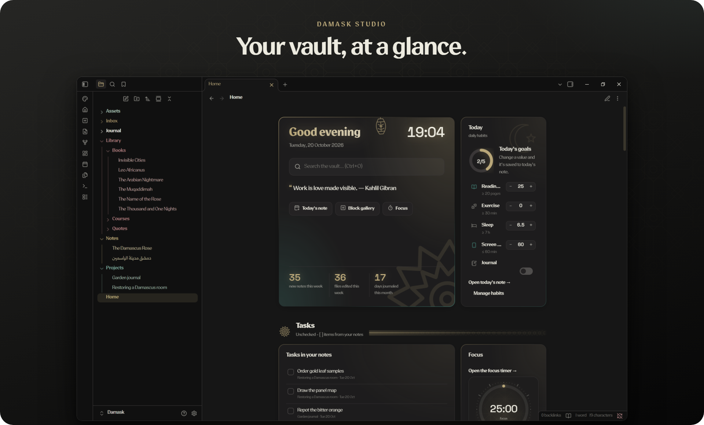
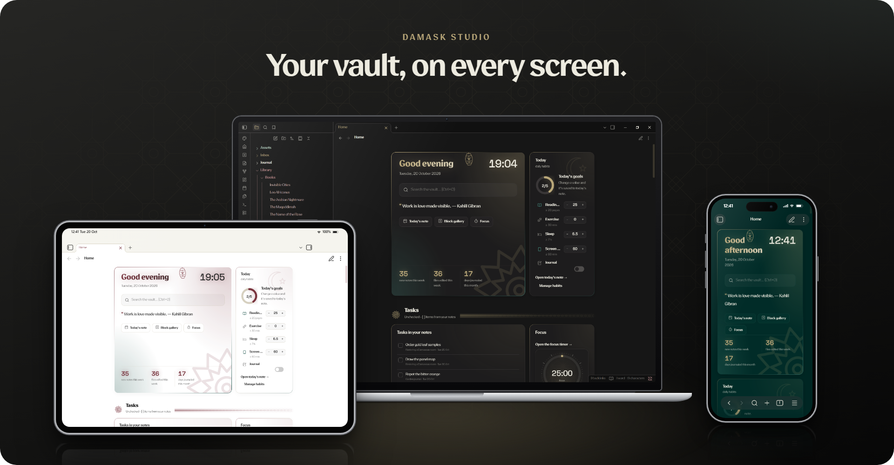
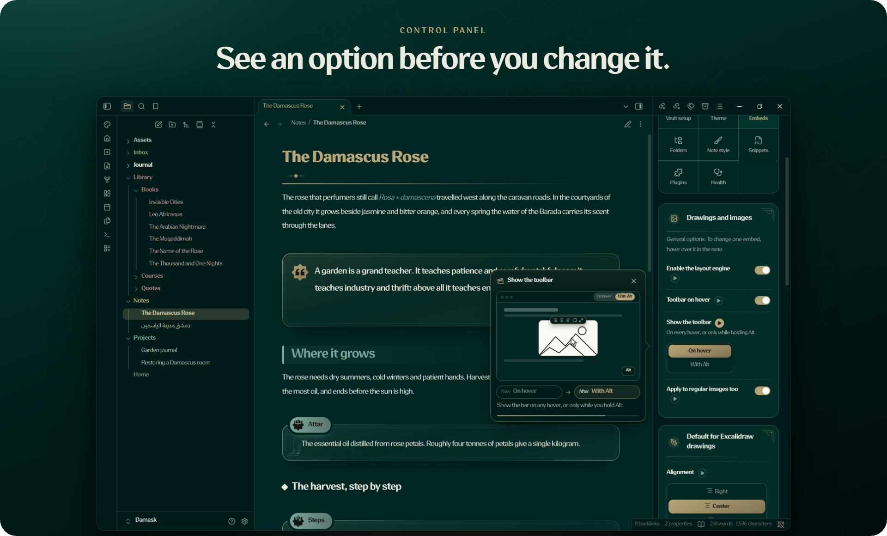

<div align="center">



<br>

### Damask Studio

The companion plugin for the [Damask](https://github.com/k7aleds8/damask) theme:<br>
a home dashboard, a block gallery, embed layouts, folder colours, a focus timer and habits — all from one control panel.

<br>

[](CHANGELOG.md)
[](https://obsidian.md)
[](#languages)
[](LICENSE)

**[Home dashboard](#home-dashboard) · [Control panel](#control-panel-with-live-previews) · [Modules](#modules) · [TickTick](#tasks-and-focus-with-or-without-ticktick) · [Install](#install) · [Languages](#languages) · [FAQ](#faq)**

</div>

<br>

Damask Studio is designed around the [Damask theme](https://github.com/k7aleds8/damask), but it does not require it: every module works with any theme. Each part has its own switch, and anything you turn off is unloaded completely — its commands, its ribbon icon and its styles.

**Why "Damask"?** Damask is the English word for the patterned silk first woven in Damascus, and the name of the city's rose. Like the fabric, whose pattern only shows when light falls across it, the theme and this plugin keep their ornament quiet until you look for it. The [theme's README](https://github.com/k7aleds8/damask#why-damask) tells the whole story, colours included.



## Home dashboard

Put this block in any note and it becomes a live dashboard:

````markdown
```damask-home
```
````

You get a greeting with today's date (and the Hijri date, if you like), a quote of the day from your quotes folder, today's habits with one-tap logging, your open tasks, task and focus statistics, a 26-week activity map, how your notes spread across folders, what you are reading, recent files, and a few gentle suggestions — an inbox that needs sorting, a note nobody links to, a broken link.

Cards only appear when there is something behind them. No quotes folder, no quote card. On phones the dashboard stacks into one column.

## Control panel, with live previews



Open it from the palette icon in the ribbon or from **Settings → Damask Studio**. Every module has a switch, and every option that changes how your notes look has a **live preview**: point at it (or tap ▶ on a phone) and a short silent animation plays on a miniature of your vault — in your theme's colours and your language — showing the page as it is now and as it will be after the change. If you prefer reduced motion, you see the two states side by side instead.

Every folder the plugin reads is configurable, and it follows your Daily notes or Periodic Notes settings by default. On first run a short setup asks for your language and which parts you want.

## Modules

| Module | What it does |
|---|---|
| **Home dashboard** | The live home page described above. |
| **Block gallery** | Every quote, callout, panel and divider with a preview. Type `;;` in a note for an inline picker, or right-click to wrap a selection. |
| **Embed layout** | Point at an image or Excalidraw drawing: align it, drag its edges to resize, float text around it, add a frame or a caption. Layouts can apply to one note or everywhere the file is embedded. |
| **Folder colours** | Colour folders and their files, with presets that follow the active palette. |
| **Heading colours** | Your own heading colours and styles on top of any theme. |
| **Theme palettes** | With Damask installed, pick each mode's palette with live previews. |
| **Focus timer** | Pomodoro and stopwatch in the status bar, with daily goals and a chime. |
| **Habits** | Numbers and yes/no habits kept in your daily notes' properties, logged from the dashboard. |
| **Health check** | Broken links, empty notes, drawings embedded nowhere, notes left in the vault root, and plugin settings that clash with your theme. It suggests fixes and never changes anything on its own. |

## Tasks and focus, with or without TickTick

The dashboard always shows task and focus statistics. **Where they come from is up to you:**

| | TickTick off (default) | TickTick on |
|---|---|---|
| Tasks | `- [ ]` lines in your notes, dated with the [Tasks](https://github.com/obsidian-tasks-group/obsidian-tasks) emoji format (`📅 2026-10-20`, `✅ 2026-10-21`, `⏫`) | Your TickTick lists, with a full task centre |
| Focus | Sessions from the built-in timer, kept in your vault | TickTick focus records; new sessions go to both |
| Habits | Numbers and yes/no values in your daily notes' properties | The same, kept in sync with TickTick habits |

Turning TickTick off removes its ribbon icon, commands and home sections at once. Nothing is left half-working.

<details>
<summary><b>More about the TickTick integration</b></summary>

<br>

Connect with a personal API token from TickTick's settings. The token stays on your device and is never written to your vault.

- **Task centre** — board, week, Eisenhower matrix and per-list views; drag tasks between days and lists; a detailed editor with subtasks, reminders, repeats and comments.
- **Quick add in your language** — `call the bank tomorrow at 5pm !high ^Home #errands`, `اتصل بالبنك غداً الساعة 5م !عالي`, `appeler la banque demain à 17h`, `llamar al banco mañana a las 5pm`, `bankayı ara yarın saat 17`.
- **Two-way sync with notes (optional)** — every list becomes a note. Tick, edit or delete a line and TickTick follows, and the other way round. Deletions are logged and can be restored; if a sync would delete more than five tasks at once, it stops and asks first.
- **Daily note log** — the tasks you finished today are added to today's daily note.

</details>

## Install

**From Obsidian** — *Settings → Community plugins → Browse*, search for **Damask Studio**, then *Install* and *Enable*. For the full look, install the **Damask** theme from *Settings → Appearance → Themes*.

**By hand** — download `main.js`, `manifest.json` and `styles.css` from the [latest release](https://github.com/k7aleds8/damask-studio/releases) into `.obsidian/plugins/damask-studio/`.

**Beta builds** — add `k7aleds8/damask-studio` in [BRAT](https://github.com/TfTHacker/obsidian42-brat).

## Languages

The plugin follows Obsidian's language, or the one you pick in *Vault setup*. Each language is written as product copy for people who speak it, not translated word for word: plurals follow each language's own rules (Arabic has six forms), dates and numbers are formatted locally, French gets its narrow spaces before punctuation, Spanish its opening `¿`, and Turkish sentences are built so no suffix is glued onto a name.

| | Interface | Quick-add keywords | Right-to-left |
|---|:---:|:---:|:---:|
| English | ✓ | ✓ | |
| العربية | ✓ | ✓ | ✓ |
| Français | ✓ | ✓ | |
| Español | ✓ | ✓ | |
| Türkçe | ✓ | ✓ | |

Want another language? See [CONTRIBUTING.md](CONTRIBUTING.md#translations).

## FAQ

**Do I need the Damask theme?**
No. The plugin works with any theme; with Damask it also offers the palette picker and borrows the theme's ornaments.

**Does it need TickTick?**
No. TickTick stays off until you turn it on, and the dashboard works fully from your notes.

**I installed it when it was called Damascene Studio.**
Install Damask Studio from the plugin browser and enable it: it reads the old plugin's settings, habits, layouts and focus history on first run. Old `damascene-home` blocks keep working. Then turn Damascene Studio off and remove it.

**I used Vault Studio.**
Enable Damask Studio and it copies your settings, habits, layouts and TickTick connection. Then turn Vault Studio off. The health check offers to rename the old `qm-` classes in your notes.

**Where is my data?**
Settings live in the plugin's `data.json`. Your TickTick token and sync state stay in this device's local storage and never sync with the vault.

## Credits

Made by [k7aleds8](https://github.com/k7aleds8).
*Space Grotesk*, used for the dashboard's numbers, is under the SIL Open Font License 1.1 — see [NOTICE.md](NOTICE.md). Code: [MIT](LICENSE).
